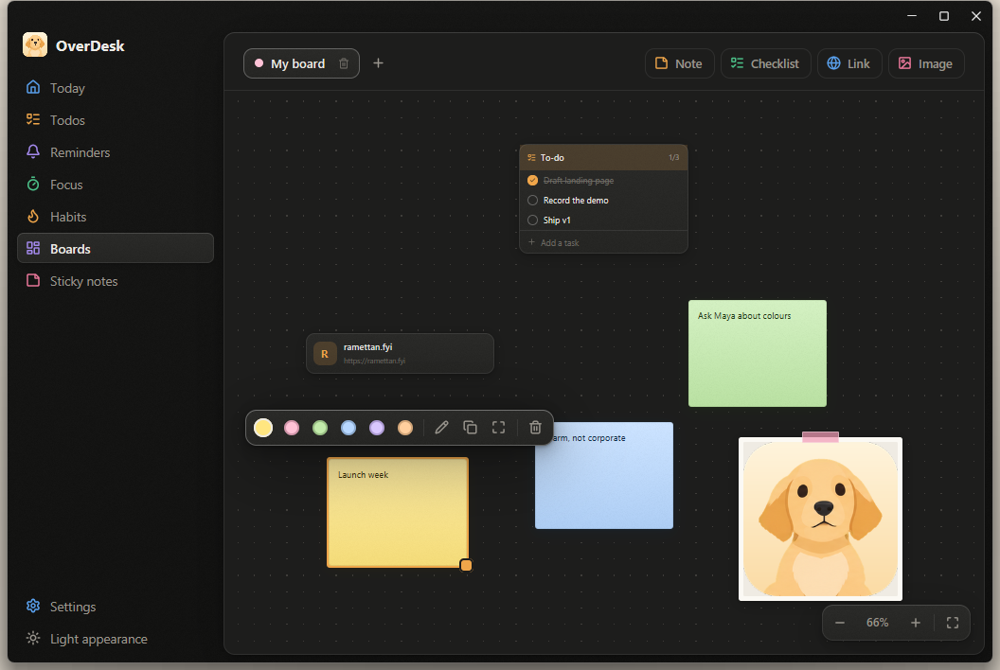

  

<h1 align="center">OverDesk</h1>

  <b>A calmer desk, with a small dog keeping watch.</b> 
  Todos, reminders, focus, habits, boards and notes for Windows — one line away, from anywhere.

  

  

## What it does

- **A dog on your taskbar.** Hover it for the things you do most. Drag it wherever you like; it parachutes back down.
- **Catch a thought in one line.** `Ctrl` + `Shift` + `Space` from anywhere, type *"call the vet tmrw 5pm high"*, press Enter. Dates, times, repeats and priorities are understood the way you type them.
- **Reminders you notice.** When one is due, a card arrives with the dog: Done, or put it off for five minutes, an hour, or until tomorrow.
- **Focus timer.** Pick a length, start. The countdown rides above the dog and gets out of your way.
- **Habits.** A handful of daily habits, a week at a glance, and one gentle check-in in the evening.
- **Boards.** A free canvas for loose ideas: coloured notes, checklists, links and pictures, wherever you put them.
- **Sticky notes.** Real notes on your desktop that tuck away to the screen edge.
- **Your day on one page.** What is due, what is left, how much you focused.

  
  

## Yours, and only yours

No account. No cloud. No tracking. Everything you write stays in one folder on your computer, and Settings can back it up with one button.

## Install

1. Download **OverDesk-Setup** from the [latest release](../../releases/latest).
2. Run it. It installs for your user only and never asks for administrator rights.
3. Windows may show a blue *"Windows protected your PC"* box, because the installer is new and not yet signed. Choose **More info → Run anyway**.

Windows 10 or 11, 64-bit. About 20 MB.

## Questions

**Is it free?** Yes.

**Is the source available?** No. OverDesk is proprietary software; this page hosts the installer only. See the [licence](LICENSE).

**Something is wrong, or I have an idea.** Open an [issue](../../issues) on this page.

---

Made by <a href="https://ramettan.fyi">Ramettan</a>

