

  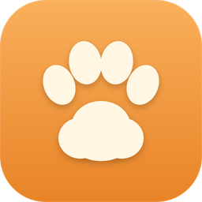

<h1 align="center">OverDesk</h1>

  <b>A calmer desk, with a small friend keeping watch.</b> 
  Todos, reminders, a focus timer, habits, boards and sticky notes for Windows. 
  One line away from anywhere, and nothing ever leaves your computer.

  
   
  Free · Windows 10 and 11 · 8 MB · no account

  
   
  <a href="media/overdesk.mp4">Watch as a video</a>

## What you get

<table>
  <tr>
    <td width="50%" valign="top">
      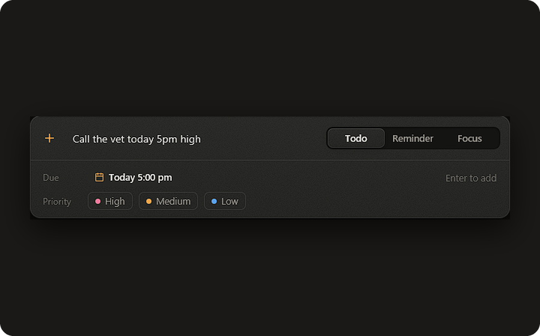
      <h3>Quick capture</h3>
      <code>Ctrl</code> + <code>Shift</code> + <code>Space</code> from anywhere, type one line, press Enter. <i>"call the vet tmrw 5pm high"</i> becomes a todo with a date, a time and a priority. Tab switches to a reminder or a focus timer.
    </td>
    <td width="50%" valign="top">
      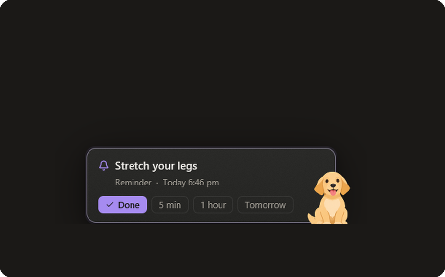
      <h3>Reminders you notice</h3>
      When one is due, a card arrives with your companion and a soft chime. Done, or put it off for five minutes, an hour, or until tomorrow. Daily, weekday, weekly and monthly repeats.
    </td>
  </tr>
  <tr>
    <td valign="top">
      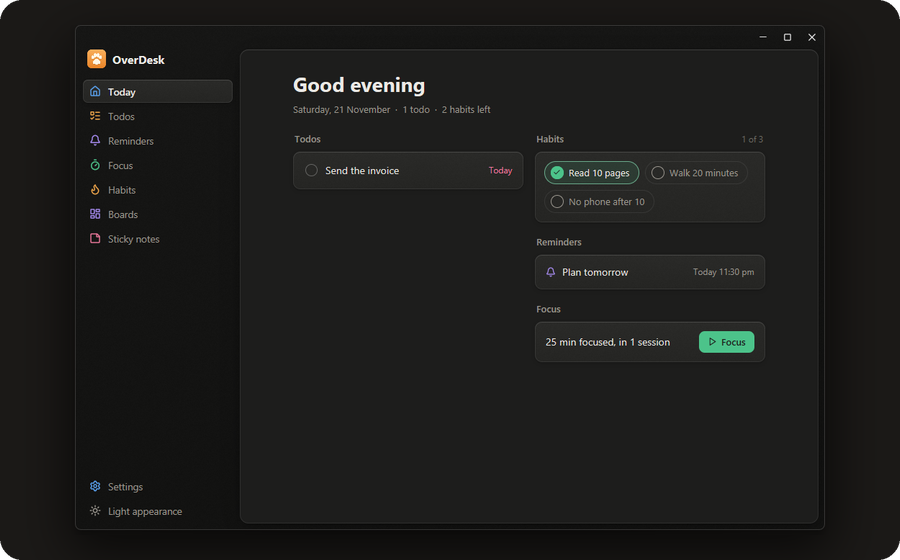
      <h3>Today</h3>
      The one page you need most days: what is due, which habits are left, what is coming up, and how long you have focused.
    </td>
    <td valign="top">
      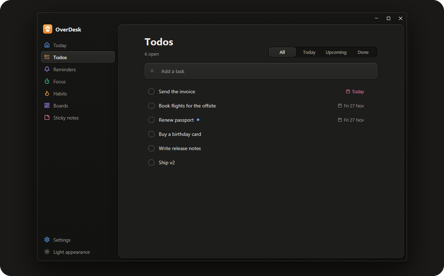
      <h3>Todos</h3>
      A plain, fast list. Deadlines, priorities, today and upcoming views. Edit in place; done is one click.
    </td>
  </tr>
  <tr>
    <td valign="top">
      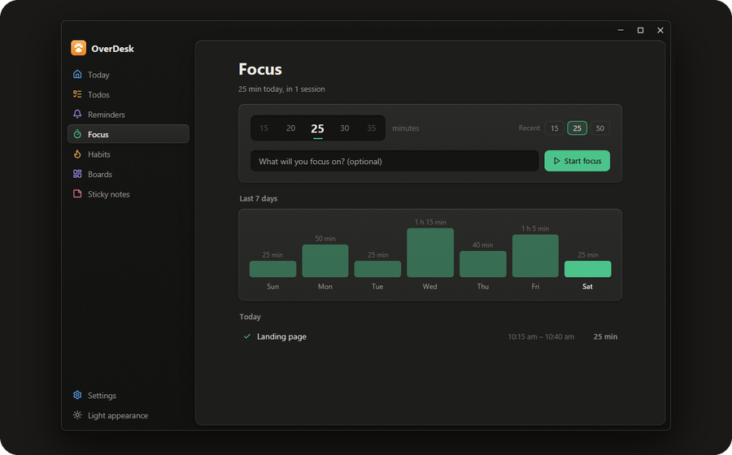
      <h3>Focus timer</h3>
      Pick a length and start. The countdown rides above your companion, breaks follow by themselves, and the week's focus time adds up in a chart.
    </td>
    <td valign="top">
      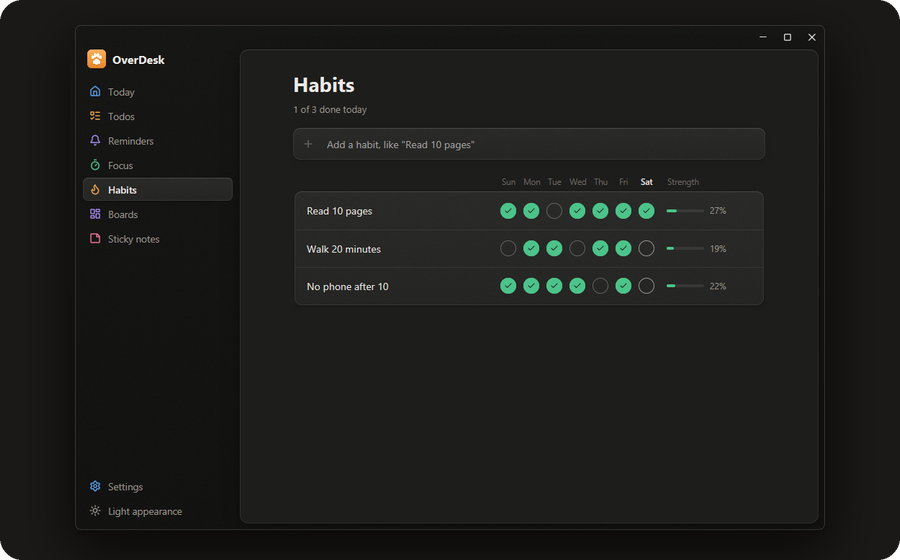
      <h3>Habits</h3>
      A handful of daily habits, a week at a glance, and a strength score that forgives one missed day. One gentle check-in in the evening.
    </td>
  </tr>
  <tr>
    <td valign="top">
      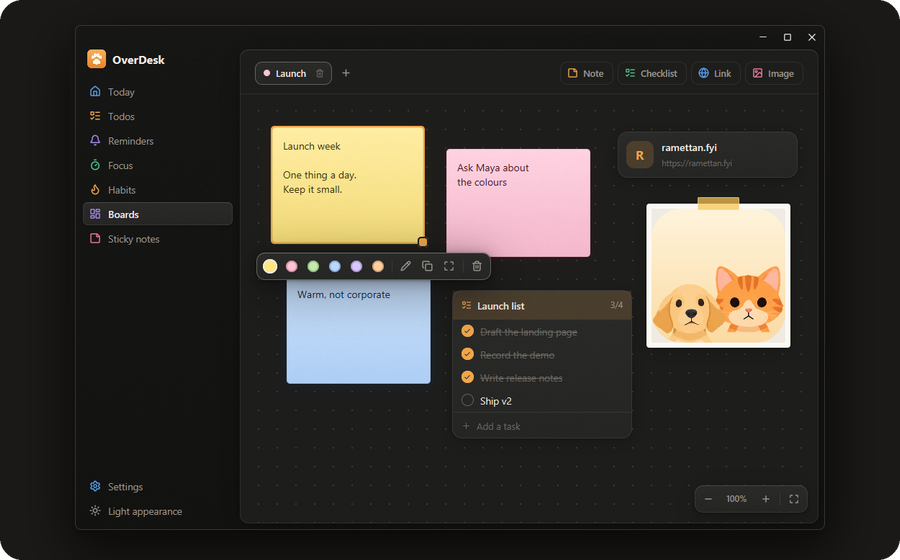
      <h3>Boards</h3>
      A free canvas for loose ideas: coloured notes, checklists of real todos, links and pictures, wherever you put them. Paste or drop anything in.
    </td>
    <td valign="top">
      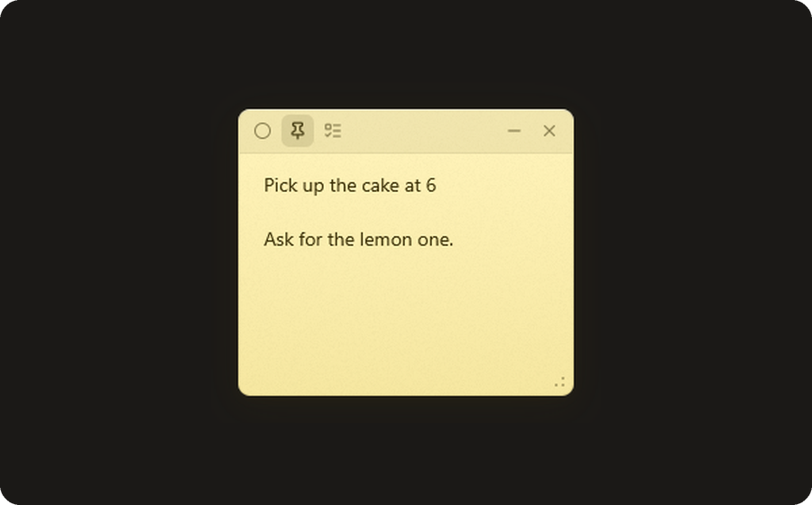
      <h3>Sticky notes</h3>
      Real notes on your desktop, in six colours. Pin them on top, tuck them away to the edge of the screen, or turn one into a todo.
    </td>
  </tr>
  <tr>
    <td valign="top">
      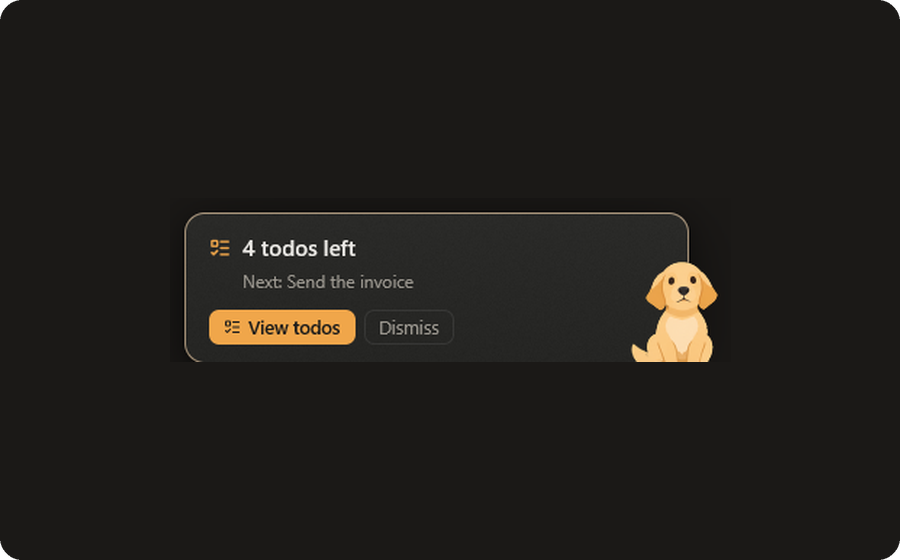
      <h3>A nudge, not a nag</h3>
      A few times a day, less often as the day goes on, your companion says how many todos are left. It stops when they are done, and stays quiet while you focus.
    </td>
    <td valign="top">
      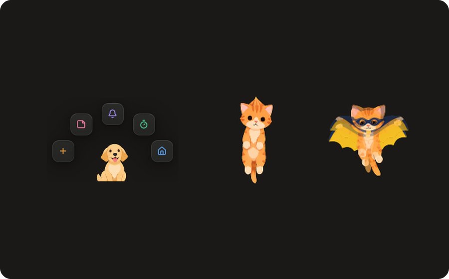
      <h3>Choose your companion</h3>
      A puppy or a kitten sits on your taskbar with your shortcuts. Pick it up and put it anywhere: the puppy parachutes down, the kitten has a cape.
    </td>
  </tr>
</table>

## Small things, done properly

- **Understands how you type.** `tmrw`, `10:00 pm`, `in 1h 30m`, `25/12`, `every weekday`, `high priority`.
- **Stays out of the way.** The companion hides when a video, game or presentation fills the screen.
- **Yours only.** No account, no cloud, no tracking. Everything is in one folder on your computer.
- **Backs up with one button**, to a folder you choose.
- **Updates itself.** OverDesk tells you when there is a new version and installs it on one click.
- **Light and dark**, and happy on touch screens.
- **Small.** An 8 MB download, about 50 MB of memory.

## Install

1. Download **OverDesk-Setup** from the [latest release](../../releases/latest).
2. Run it. It installs for your user only and never asks for administrator rights.
3. Windows may show a blue *"Windows protected your PC"* box, because the installer is not yet signed. Choose **More info → Run anyway**.

Already on version 1? Install version 2 over it once; your data is kept. From then on OverDesk updates itself.

## Questions

**Is it free?** Yes.

**Is the source available?** No. OverDesk is proprietary software; this page hosts the installer only. See the [licence](LICENSE).

**Something is wrong, or I have an idea.** Open an [issue](../../issues).

---

Made by <a href="https://ramettan.fyi">Ramettan</a>

